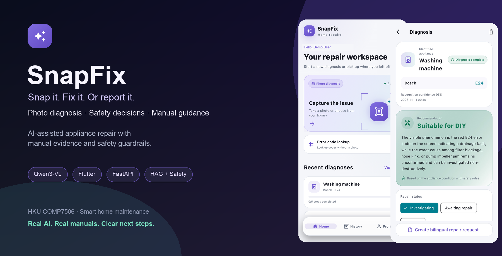
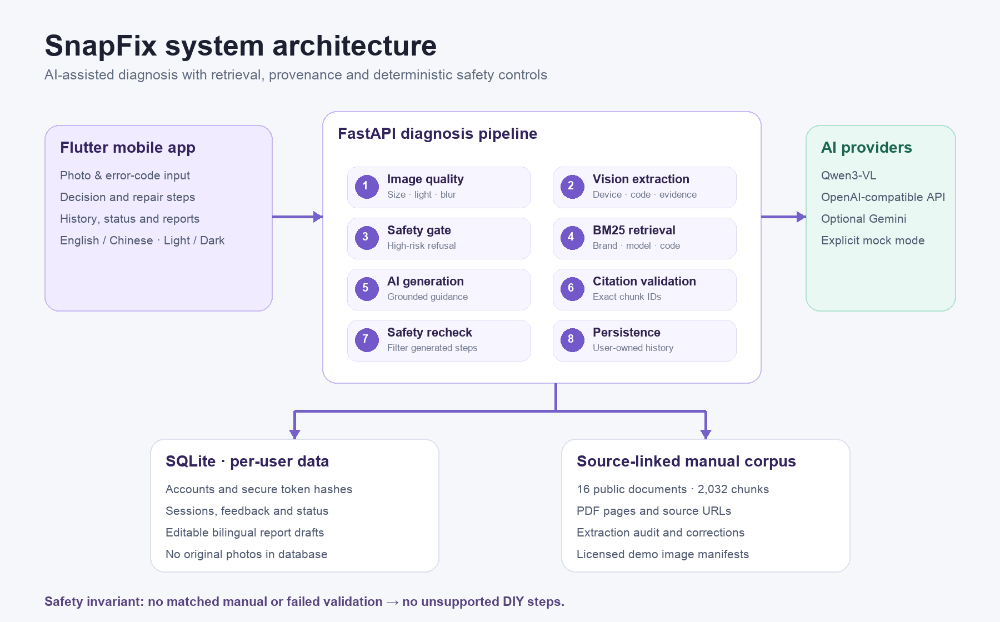

<div align="center">

# COMP7506 Group Project SnapFix

**Snap it. Fix it. Or report it.**

AI-assisted appliance repair with manual evidence, safety guardrails, and bilingual repair requests.

**[English](README.md) · [简体中文](README.zh-CN.md)**

[](https://github.com/junjiacaohku-ai/COMP7506-Group-Project-SnapFix)
[](https://flutter.dev/)
[](https://fastapi.tiangolo.com/)
[](https://www.alibabacloud.com/help/en/model-studio/qwen-vl-compatible-with-openai)
[](https://github.com/junjiacaohku-ai/COMP7506-Group-Project-SnapFix/tree/main/server/tests)
[](https://github.com/junjiacaohku-ai/COMP7506-Group-Project-SnapFix/stargazers)



[Overview](#overview) · [Features](#features) · [Architecture](#architecture) · [Quick Start](#quick-start) · [Evaluation](#evaluation) · [Limitations](#limitations)

</div>

---

<a id="overview"></a>
## 1. Overview

SnapFix is a smart-home maintenance application for people who know an appliance is not working but do not know the model, the correct instructions, or how to explain the problem to a landlord or technician.

A photo or error code becomes a structured action plan: what is visible, whether DIY is appropriate, which manual supports each step, and how to ask for professional help. The goal is not another general-purpose chatbot, but a complete **diagnosis → safety decision → repair or report** workflow.

> **Safety notice:** SnapFix provides AI-assisted guidance, not a professional inspection. High-risk devices and unsupported repairs are referred to qualified technicians.

<a id="features"></a>
## 2. Product Features

| Capability | Delivered behavior |
|---|---|
| **Photo diagnosis** | Qwen3-VL extracts the appliance, visible symptoms, labels, and error codes without inventing missing details. |
| **Manual lookup** | Error-code input provides a non-camera path into the same retrieval and diagnosis workflow. |
| **Grounded guidance** | Repair steps cite exact manual chunks with source text, PDF pages, and source URLs. |
| **Safety guardrails** | Deterministic rules run before generation and again on generated steps. |
| **Repair tracking** | Mark steps done, skipped, or not useful; tap again to undo. Progress is persisted. |
| **Repair status** | Track investigating, awaiting repair, and resolved states with history filters. |
| **Bilingual reports** | Edit, save, reset, copy, and share Chinese or English repair requests. |
| **Real accounts** | Email, Sign in with Apple, and Google OAuth with per-user data isolation. |
| **Appearance & language** | English and Simplified Chinese, light/dark/system appearance, and reduced motion. |
| **Explicit demo mode** | Deterministic scenarios work without a model key and are clearly labelled. |

<a id="architecture"></a>
## 3. System Architecture

<div align="center">

</div>

The architecture deliberately separates probabilistic AI output from deterministic safety and evidence checks. A model may propose guidance, but it cannot bypass the safety gate or introduce an untraceable citation.

### Diagnosis pipeline

1. **Image quality** — Validate file size, dimensions, brightness, sharpness, and image readability.
2. **Vision extraction** — Extract device category, brand, model, error code, visible symptoms, and confidence as structured JSON.
3. **Safety gate** — Refuse high-risk categories before any repair generation.
4. **BM25 retrieval** — Rank real manual chunks using brand aliases, category filters, bilingual expansion, and normalized error codes.
5. **Grounded generation** — Ask the provider for a decision and steps constrained to the retrieved evidence and current interface language.
6. **Citation validation** — Accept only exact chunk IDs returned by retrieval; preserve source text and PDF pages.
7. **Generated-content safety review** — Drop generated steps that introduce dangerous operations, even when a citation exists.
8. **Persistence** — Save the session, feedback, repair status, and editable reports under the authenticated user.

## 4. Evidence and Data

| Asset | Current contents | Purpose |
|---|---|---|
| **Manual corpus** | 16 public documents, 2,032 text chunks | Model-specific evidence retrieval and source inspection |
| **Provenance** | Source URLs, PDF pages, stable chunk IDs, source hashes | Trace a generated step back to its original document |
| **Extraction audit** | Sparse pages, undecodable pages, extractor records, source-bound corrections | Prevent unreadable PDF content from being treated as reliable text |
| **Public demo images** | Attribution, licences, hashes, and usage notes | Reproducible demonstrations without claiming confirmed faults |
| **Quality variants** | 26 controlled dark/blur transformations | Repeatable image-quality regression checks |

**Important:** Public appearance photographs demonstrate input and quality handling; they are not labelled proof of real-world diagnostic accuracy.

<a id="quick-start"></a>
## 5. Quick Start

### Requirements

- Python **3.11+**
- Flutter **3.47.7** or a compatible newer version
- Xcode / CocoaPods for iOS Simulator
- Optional: Alibaba Cloud Model Studio Qwen API Key for live AI

### Backend

```bash
cd server
python3 -m venv .venv
source .venv/bin/activate             # Windows: .venv\Scripts\Activate.ps1
python -m pip install -r requirements.txt
cp .env.example .env                   # Optional; never commit this file
python -m uvicorn main:app --reload --port 8001
```

The first launch imports the manual corpus into SQLite automatically.

Health check:

```bash
curl http://127.0.0.1:8001/api/health
```

The response explicitly identifies `qwen`, `gemini`, or `mock`.

### Live Qwen configuration

1. Enable **Alibaba Cloud Model Studio** and select **China (Hong Kong)**.
2. Create an API Key in the same region and confirm `qwen3-vl-plus` availability.
3. Add the following to `server/.env`:

```dotenv
AI_PROVIDER=qwen
DASHSCOPE_API_KEY=your_local_key
DASHSCOPE_BASE_URL=https://cn-hongkong.dashscope.aliyuncs.com/compatible-mode/v1
QWEN_MODEL=qwen3-vl-plus
```

A workspace-specific API Host can replace `DASHSCOPE_BASE_URL`; keep `/compatible-mode/v1`. The Key, region, and Base URL must match. Never commit real credentials.

To use Gemini instead:

```dotenv
AI_PROVIDER=gemini
GEMINI_API_KEY=your_local_key
```

### Flutter app

```bash
cd app
flutter pub get
flutter run
```

- iOS Simulator uses `http://127.0.0.1:8001`.
- Android Emulator uses `http://10.0.2.2:8001` after changing the API address.
- A physical phone requires a reachable LAN or deployed backend; its own `127.0.0.1` is not your computer.

Google sign-in is optional and hidden until OAuth Client IDs are supplied. Apple sign-in requires the corresponding Apple Developer configuration.

## 6. Demo Scenarios

| Scenario | Input | Expected result |
|---|---|---|
| Router indicator | Known demo photo or filename containing `router` / `tplink` | TP-Link external troubleshooting with labelled demo sources |
| Bosch E24 | Brand `Bosch`, code `E24` | Deterministic washer demonstration in mock mode; real corpus retrieval in online mode |
| IKEA BILLY | Known demo photo or filename containing `ikea` / `billy` | Assembly guidance and anti-tip warning |
| Microwave | Known demo photo or filename containing `microwave` | Safety refusal, no DIY steps, repair-request entry |
| Poor image | Dark, blurred, tiny, invalid, or oversized image | HTTP 422 with a localized retake explanation |
| Repair request | Complete a diagnosis and open the report sheet | Editable Chinese and English drafts, copy and share |

**Mock integrity:** Unknown images are rejected rather than randomly assigned to an unrelated scenario.

## 7. Project Structure

```text
COMP7506-Group-Project-SnapFix/
├── app/                         # Flutter mobile application
│   ├── lib/pages/               # Scan, analysis, diagnosis, history, profile
│   ├── lib/models.dart          # Session, source, status and account models
│   └── test/                    # Model and product workflow tests
├── server/
│   ├── main.py                  # Authenticated FastAPI endpoints
│   ├── pipeline.py              # Quality, safety, retrieval and citation pipeline
│   ├── providers.py             # Qwen / Gemini provider adapters
│   ├── retrieval.py             # BM25, aliases and error-code normalization
│   ├── corpus.py                # Reproducible PDF extraction
│   ├── corpus_store.py          # Validated, idempotent corpus import
│   ├── image_quality.py         # Conservative image checks
│   ├── data/                    # Manuals, chunks, provenance and audits
│   └── tests/                   # Isolated backend regression tests
├── docs/
│   ├── assets/                  # README visuals and real UI screenshots
│   └── demo-assets/             # Attributed public images and quality variants
├── demo-photos/                 # Four original synthetic demonstration images
├── README.md                    # English project homepage
└── README.zh-CN.md              # 简体中文项目主页
```

<a id="evaluation"></a>
## 8. Evaluation

### Automated checks

```bash
# Backend: isolated temporary database; no live model calls
cd server
.venv/bin/python -m pip install -r requirements.txt -r requirements-dev.txt
.venv/bin/python -m pytest tests -q

# Flutter: model, source, feedback, status and report workflows
cd app
flutter analyze
flutter test
```

| Verification | Current result | What it does—and does not—establish |
|---|---|---|
| Backend regression | **46 passed** | Corpus, retrieval, safety, image quality, account isolation, status and drafts |
| Flutter tests | **5 passed** | Model parsing and product interaction logic |
| Flutter static analysis | **No issues found** | Static Dart quality, not device compatibility |
| Image-quality variants | **26 controlled cases** | Dark/blur retake behavior, not diagnostic accuracy |
| Real Qwen HTTP flows | **Router, microwave, Bosch E24 checked** | Live provider integration and source validation on those scenarios |
| Manual corpus | **16 documents / 2,032 chunks** | Available evidence coverage, not universal appliance support |

### Validation principles

- Live AI failures never return unrelated mock diagnoses.
- No matched manual or failed validation means no unsupported DIY steps.
- Mock success, screenshot appearance, and public photos are not presented as model accuracy evidence.

## 9. Privacy and Security

- Passwords use salted PBKDF2 hashes; server-stored access tokens are hashed.
- Device tokens use Keychain / Android Keystore through secure storage.
- Original photos are not written to SQLite; online diagnosis sends images to the configured AI provider.
- Sessions, preferences, reports, and deletion operations are scoped to the authenticated user.
- Account deletion removes associated user data through backend cascading rules.

<a id="limitations"></a>
## 10. Limitations

SnapFix is currently a course project and a local-first development build, not a deployed public repair service. The corpus covers a small set of devices, and the current tests do not establish broad diagnostic accuracy.

Camera permissions, system notifications, sharing, and OAuth should still receive physical-device validation before production use. A known iOS 26.3 Simulator rendering issue affects transient Toast presentation; see [`docs/openissues-2026-10-23.md`](docs/openissues-2026-10-23.md).

## 11. Roadmap

- [ ] Expand confirmed fault photographs and manual coverage.
- [ ] Complete physical-device camera, notification, sharing, and OAuth checks.
- [ ] Add production deployment, operational monitoring, and public privacy pages.
- [ ] Evaluate recognition and safety on a larger labelled dataset.
- [ ] Improve multi-turn follow-up without weakening evidence requirements.

## 12. Documentation and Acknowledgements

### Project documents

- [Project report PDF](docs/report/snapfix-report.pdf)
- [Report LaTeX source](docs/report/snapfix-report.tex)
- [Demo video script](docs/video-script.md)
- [Validation and reproduction guide](docs/validation.md)
- [Manual source manifest](server/data/manifest.json)
- [Public image attribution](docs/demo-assets/public/sources.json)
- [Known issues](docs/openissues-2026-10-23.md)

### Team provenance

This Solo mainline integrates selected outputs from the original team workstreams. The table records the original team roles and the sources referenced by this repository; it is not a claim that every team feature was merged unchanged.

| Contributor | Original team role | Workstream and coordination responsibilities |
|---|---|---|
| **Cao Junjia** | **Team lead · BE-1 pipeline** | Team planning and task coordination; backend architecture, API contracts, providers and safety; integration review, PR coordination and submission planning |
| **Shi Junying** | BE-2 retrieval & storage | BM25 retrieval, SQLite persistence, reporting endpoints and backend documentation |
| **Zhu Yutaimin** | FE-1 scan & diagnosis | Flutter foundations, shared components, home, camera, preview and diagnosis flow |
| **Yang Ruijia** | FE-2 guidance & archive | Step guidance, repair history, report interactions, visual design and video materials |
| **Zhang Fan** | Data & content | Corpus ETL, demonstration scenarios, market research, acceptance records and attributed image assets |

Third-party manuals and photographs retain their respective source terms and licences.

---

<div align="center">

**SnapFix — Real AI. Real manuals. Clear next steps.**

HKU COMP7506 · Smart Home Maintenance · Flutter + FastAPI + Qwen3-VL

</div>
