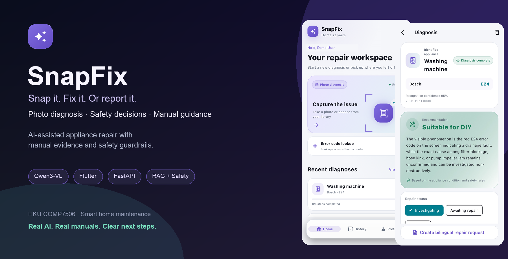
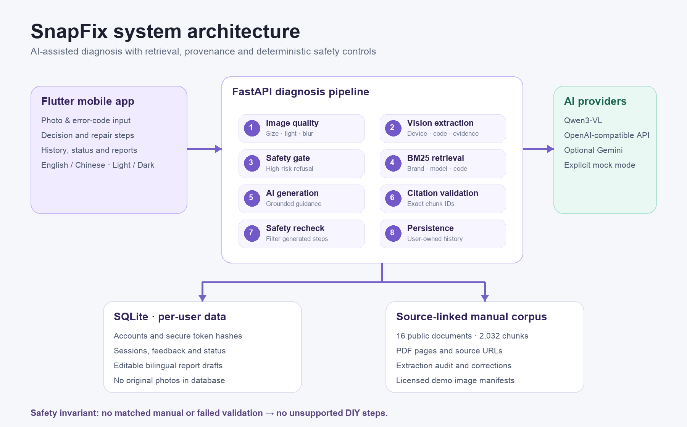

<div align="center">

# SnapFix 随手修

**先搞懂，再决定。**

拍照诊断家电问题，提供有手册依据的维修指导、安全决策与中英双语报修。

**[English](README.md) · [简体中文](README.zh-CN.md)**

[](https://github.com/junjiacaohku-ai/snapfix-solo)
[](https://flutter.dev/)
[](https://fastapi.tiangolo.com/)
[](https://www.alibabacloud.com/help/en/model-studio/qwen-vl-compatible-with-openai)
[](https://github.com/junjiacaohku-ai/snapfix-solo/tree/main/server/tests)
[](https://github.com/junjiacaohku-ai/snapfix-solo/stargazers)



[项目概述](#overview) · [产品功能](#features) · [系统架构](#architecture) · [快速开始](#quick-start) · [测试与验证](#evaluation) · [边界与限制](#limitations)

</div>

---

<a id="overview"></a>
## 1. 项目概述

SnapFix 面向租房青年和智能家居用户。用户知道设备出现故障，却往往不知道设备型号、对应说明书，也不知道如何向房东或维修师傅清楚描述问题。

用户只需拍摄设备、铭牌或错误码，即可获得结构化建议：看到了什么、是否适合自行处理、每个步骤来自哪份手册，以及如何寻求专业帮助。目标不是做一个通用聊天机器人，而是完成“**诊断 → 安全决策 → 维修／报修**”的完整流程。

> **安全说明：** SnapFix 提供 AI 辅助建议，不能替代专业检修；高风险或无可靠依据的操作不会提供自行拆解步骤。

<a id="features"></a>
## 2. 产品功能

| 功能 | 已实现能力 |
|---|---|
| **拍照诊断** | 使用 Qwen3-VL 识别设备、可见现象、铭牌与错误码；无法确认的信息保持为空。 |
| **错误码查询** | 无需拍照，输入品牌与错误码即可进入相同的手册检索和诊断流程。 |
| **有依据的维修指导** | 真实步骤绑定手册 chunk，可查看原文、PDF 页码与来源链接。 |
| **安全保护** | 生成前后均执行确定性安全检查，危险内容直接拒答或丢弃。 |
| **维修进度** | 步骤支持完成、跳过、无效与再次点击撤销，进度会持久化保存。 |
| **维修状态** | 档案支持排查中、待维修、已解决状态及筛选。 |
| **双语报修** | 报修内容支持中英文编辑、保存、重置、复制和系统分享。 |
| **真实账号** | 支持邮箱、Apple、Google 登录，诊断和设置按账号隔离。 |
| **外观与语言** | 支持中英文、日间／夜间／跟随系统及减少动态效果。 |
| **明确的演示模式** | 无模型 Key 时可使用明确标识的演示场景，不冒充真实 AI 识别。 |

<a id="architecture"></a>
## 3. 系统架构

<div align="center">

</div>

系统将 AI 的概率性输出与确定性的安全、引用校验分离。模型只能提出建议，不能绕过安全门，也不能为步骤添加无法追溯的来源。

### 诊断管线

1. **图片质量门**——检查文件大小、像素、分辨率、亮度、清晰度与图片有效性。
2. **视觉信息提取**——以结构化 JSON 提取设备、品牌、型号、错误码、可见现象与模型置信信息。
3. **生成前安全门**——在生成维修步骤前拦截高压电、燃气、制冷剂、锂电池等高危场景。
4. **BM25 手册检索**——通过品牌别名、类别过滤、中英文扩展和错误码归一化检索真实手册片段。
5. **有依据生成**——要求模型仅依据检索片段生成决策与步骤，并跟随当前界面语言。
6. **引用校验**——只接受检索结果中的真实 chunk ID，并保留原文与 PDF 页码。
7. **生成后安全复核**——即使模型附带引用，新增的危险操作仍会被删除。
8. **持久化**——将诊断、反馈、维修状态和报修草稿保存到当前账号。

## 4. 数据与来源

| 资产 | 当前内容 | 用途 |
|---|---|---|
| **手册语料** | 16 份公开资料、2,032 个文本块 | 为设备提供可检索、可核对的手册依据 |
| **来源信息** | 来源 URL、PDF 页码、稳定 chunk ID、源文件哈希 | 将生成步骤追溯至原始资料 |
| **提取审计** | 稀疏页面、解码失败页面、提取器记录、绑定源文件的文本修正 | 避免将无法读取的 PDF 内容当作可靠文本 |
| **公开演示图片** | 作者、许可、哈希与用途说明 | 提供可复现演示，同时不声称图片已确认故障 |
| **质量测试变体** | 26 张受控暗化／模糊处理图 | 可重复执行图片质量回归检查 |

**注意：** 公开设备外观图只能用于流程与质量测试，不能作为真实故障识别准确率证据。

<a id="quick-start"></a>
## 5. 快速开始

### 环境要求

- Python **3.11+**
- Flutter **3.47.7** 或兼容的更新版本
- 使用 iOS 模拟器时需要 Xcode / CocoaPods
- 可选：阿里云百炼 Qwen API Key，用于真实在线诊断

### 启动后端

```bash
cd server
python3 -m venv .venv
source .venv/bin/activate             # Windows：.venv\Scripts\Activate.ps1
python -m pip install -r requirements.txt
cp .env.example .env                   # 可选；不要提交此文件
python -m uvicorn main:app --reload --port 8001
```

首次启动会自动导入手册语料，无需手动创建数据库。

健康检查：

```bash
curl http://127.0.0.1:8001/api/health
```

返回结果会明确标识当前使用 `qwen`、`gemini` 或 `mock`。

### 配置真实 Qwen

1. 开通 **阿里云 Model Studio（百炼）**，选择 **中国香港** 地域。
2. 在同一地域创建 API Key，并确认 `qwen3-vl-plus` 可用。
3. 在 `server/.env` 中添加：

```dotenv
AI_PROVIDER=qwen
DASHSCOPE_API_KEY=你的本地Key
DASHSCOPE_BASE_URL=https://cn-hongkong.dashscope.aliyuncs.com/compatible-mode/v1
QWEN_MODEL=qwen3-vl-plus
```

也可使用工作空间专属 API Host 替换 `DASHSCOPE_BASE_URL`，并保留 `/compatible-mode/v1`。Key、地域和 Base URL 必须一致，真实 Key 不得提交到 Git。

如需改用 Gemini：

```dotenv
AI_PROVIDER=gemini
GEMINI_API_KEY=你的本地Key
```

### 启动 Flutter App

```bash
cd app
flutter pub get
flutter run
```

- iOS 模拟器使用 `http://127.0.0.1:8001`。
- Android 模拟器需将 API 地址改为 `http://10.0.2.2:8001`。
- 真机需要配置电脑局域网地址或可访问的后端，不能使用手机自身的 `127.0.0.1`。

Google 登录需配置 OAuth Client ID，未配置时按钮隐藏；Apple 登录需完成 Apple Developer 对应配置。

## 6. 演示场景

| 场景 | 输入方式 | 预期结果 |
|---|---|---|
| 路由器指示灯 | 已知演示照片，或文件名包含 `router` / `tplink` | TP-Link 外部排查步骤，并明确标识演示来源 |
| Bosch E24 | 品牌 `Bosch`、错误码 `E24` | mock 模式提供确定性洗衣机演示；在线模式检索真实语料 |
| IKEA BILLY | 已知演示照片，或文件名包含 `ikea` / `billy` | 组装指导与防倾倒警告 |
| 微波炉 | 已知演示照片，或文件名包含 `microwave` | 安全拒答、不提供 DIY 步骤，并可直接报修 |
| 不合格图片 | 过暗、模糊、过小、无效或超大图片 | HTTP 422，并显示当前语言的重拍说明 |
| 报修 | 完成诊断后打开报修面板 | 可编辑的中英文草稿，支持复制与分享 |

**演示完整性：** 未知图片会明确拒绝，不再随机生成无关诊断。

## 7. 项目结构

```text
snapfix-solo/
├── app/                         # Flutter 移动应用
│   ├── lib/pages/               # 拍照、分析、诊断、档案、个人中心
│   ├── lib/models.dart          # 诊断、来源、状态和账号模型
│   └── test/                    # 模型与产品流程测试
├── server/
│   ├── main.py                  # 需要鉴权的 FastAPI 接口
│   ├── pipeline.py              # 质量、安全、检索与引用管线
│   ├── providers.py             # Qwen / Gemini 服务适配
│   ├── retrieval.py             # BM25、别名与错误码归一化
│   ├── corpus.py                # 可复现 PDF 提取
│   ├── corpus_store.py          # 经过校验的幂等语料导入
│   ├── image_quality.py         # 保守的图片质量检查
│   ├── data/                    # 手册、文本块、来源与审计
│   └── tests/                   # 隔离的后端回归测试
├── docs/
│   ├── assets/                  # README 主视觉与真实界面截图
│   └── demo-assets/             # 保留署名的公开图片与质量变体
├── demo-photos/                 # 四张原创合成演示图片
├── README.md                    # English project homepage
└── README.zh-CN.md              # 简体中文项目主页
```

<a id="evaluation"></a>
## 8. 测试与验证

### 自动化检查

```bash
# 后端：使用独立临时数据库，不调用真实模型
cd server
.venv/bin/python -m pip install -r requirements.txt -r requirements-dev.txt
.venv/bin/python -m pytest tests -q

# Flutter：模型、来源、反馈、状态与报修流程
cd app
flutter analyze
flutter test
```

| 验证项目 | 当前结果 | 能证明与不能证明的内容 |
|---|---|---|
| 后端回归测试 | **46 项通过** | 语料、检索、安全、图片质量、账号隔离、状态与报修草稿 |
| Flutter 测试 | **5 项通过** | 模型解析与产品交互逻辑 |
| Flutter 静态分析 | **无问题** | Dart 静态质量，不代表设备兼容性 |
| 图片质量变体 | **26 个受控用例** | 暗化／模糊重拍行为，不代表诊断准确率 |
| 真实 Qwen HTTP 流程 | **路由器、微波炉、Bosch E24 已验证** | 这些场景的真实模型接入与来源校验 |
| 手册语料 | **16 份资料／2,032 个文本块** | 当前可用的证据覆盖，不代表支持所有家电 |

### 验证原则

- 真实 AI 失败不会返回无关 mock 诊断。
- 无匹配手册或校验失败时，不提供无依据的自行维修步骤。
- 不把 mock 成功、界面截图或公开外观照片包装成模型准确率。

## 9. 隐私与安全

- 密码使用加盐 PBKDF2，服务端只保存访问令牌哈希。
- 设备令牌通过安全存储使用 Keychain／Android Keystore。
- 原图不写入数据库；在线诊断会将照片发送至当前配置的模型服务。
- 诊断、偏好、报修和删除操作均按当前账号隔离。
- 删除账号会按后端级联规则清理关联数据。

<a id="limitations"></a>
## 10. 边界与限制

当前版本是课程项目和本地开发构建，并非已经部署的公共维修服务。手册覆盖范围有限，现有测试不能证明广泛的诊断准确率。

正式使用前仍需在真机验证相机权限、系统通知、分享和 OAuth 登录。iOS 26.3 模拟器的瞬时 Toast 存在已知渲染问题，详见 [`docs/openissues-2026-10-23.md`](docs/openissues-2026-10-23.md)。

## 11. 后续方向

- [ ] 扩充已确认故障照片与手册覆盖。
- [ ] 完成真机相机、通知、分享和 OAuth 验收。
- [ ] 增加正式部署、运行监控与公开隐私页面。
- [ ] 在更大标注数据集上评估识别与安全性。
- [ ] 在不降低引用要求的前提下完善多轮续诊。

## 12. 文档与致谢

### 项目文档

- [官方课程要求汇总](2026-11-10%20Group%20Project%20官方要求汇总.md)
- [交付计划](docs/2026-11-10-今日交付计划.md)
- [手册来源清单](server/data/manifest.json)
- [公开图片署名与许可](docs/demo-assets/public/sources.json)
- [已知问题](docs/openissues-2026-10-23.md)

### 团队成果来源

本 Solo 主线有选择地整合了团队原有工作线的成果。下表记录团队原来的分工及本仓库参考的来源，不表示所有团队功能都未经修改直接合入。

| 成员 | 团队原分工 | 工作线与统筹职责 |
|---|---|---|
| **曹峻嘉** | **组长 · BE-1 管线** | 项目规划与任务统筹；后端架构、API 契约、Provider 与安全门；集成验收、PR 协调与提交统筹 |
| **史珺瑛** | BE-2 检索与存储 | BM25 检索、SQLite 持久化、报修接口与后端文档 |
| **朱雨泰民** | FE-1 扫描与诊断 | Flutter 基础、共享组件、首页、相机、预览与诊断流程 |
| **杨蕊嘉** | FE-2 指导与档案 | 分步指导、维修档案、报修交互、视觉设计与视频材料 |
| **张帆** | 数据与内容 | 语料 ETL、演示场景、市场调研、验收记录与带来源的公开图片 |

原[团队仓库](https://github.com/junjiacaohku-ai/snapfix)及贡献记录继续保留。第三方手册与照片遵循各自来源条款和许可。

---

<div align="center">

**SnapFix——真实 AI，真实手册，清楚的下一步。**

HKU COMP7506 · 智能家居维修 · Flutter + FastAPI + Qwen3-VL

</div>
