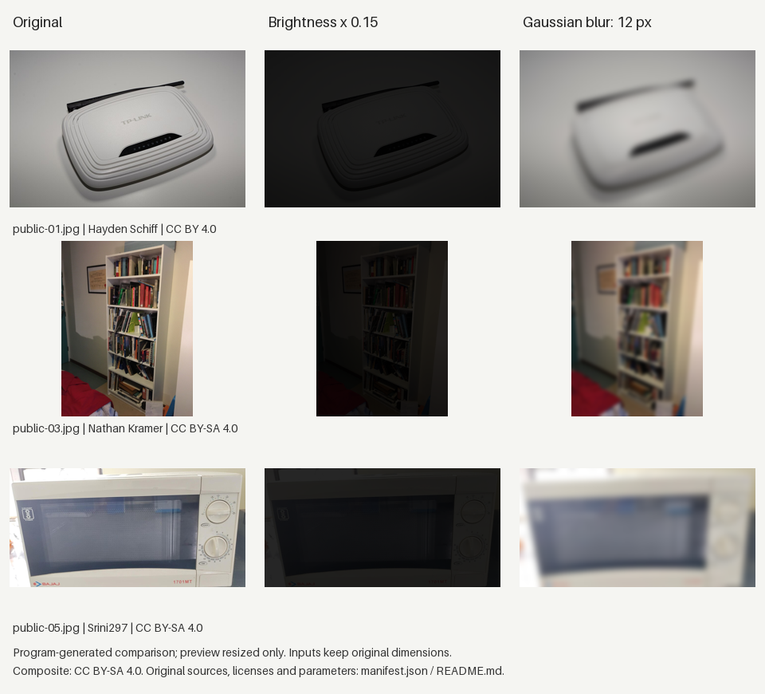

# 图片对照实验

13张公开原图去重后各做两种处理，得到26张处理图，原文件保留：

- 暗化：RGB通道亮度乘以0.15。
- 模糊：在原尺寸上做半径12像素的高斯模糊。

处理前统一EXIF方向并转RGB，不缩放；结果存为无损PNG。来源、作者、原许可和处理方式写进PNG信息及`manifest.json`。各张处理图沿用对应原图许可，来源表见[public/sources.json](../public/sources.json)。

提交清单的13张原图中，12张基线放行，1张本来偏暗；26张处理图均预期重拍。模糊检查应只将12张基线放行原图纳入分母，不能把本来偏暗的照片算作模糊识别成功。同设备的多张照片归入同组，共10个来源组。这只是强暗化／强模糊对照，不能当作手机拍摄准确率或故障识别结果。

## 当前复现方式

在`server/`安装项目及测试依赖后运行：

```sh
# 核对已提交的原图、处理图、语料和清单哈希，不改动文件
python experiments/validate_data_assets.py
# 在临时目录重建两次，检查结果可重复、原图未改动及26张图的质量门行为
python -m pytest tests/test_quality_variants.py -q
# 如需输出一套处理图，使用独立目录保留原始提交
python experiments/build_quality_variants.py --output ../../quality-rebuild
```

当前检查直接调用质量门，不是39次HTTP上传记录。旧说明引用的`evaluate_quality_variants.py`及`quality-variant-results.json`未包含在集成仓库中，当前结果以可复跑测试为准。Python、Pillow版本和输入输出哈希记录在生成清单中；跨版本的PNG压缩字节可能变化，应同时保留运行环境和新清单。



预览图仅为展示缩小。三行原图分别来自[Hayden Schiff](https://commons.wikimedia.org/wiki/File:TP-Link_TL-WR740N_router_HS2.jpg)（[CC BY 4.0](https://creativecommons.org/licenses/by/4.0/)）、[Nathan Kramer](https://commons.wikimedia.org/wiki/File:Billy_Bookcase.jpg)和[Srini297](https://commons.wikimedia.org/wiki/File:Microwave_Oven.jpg)（均为[CC BY-SA 4.0](https://creativecommons.org/licenses/by-sa/4.0/)）；拼图按CC BY-SA 4.0提供。
